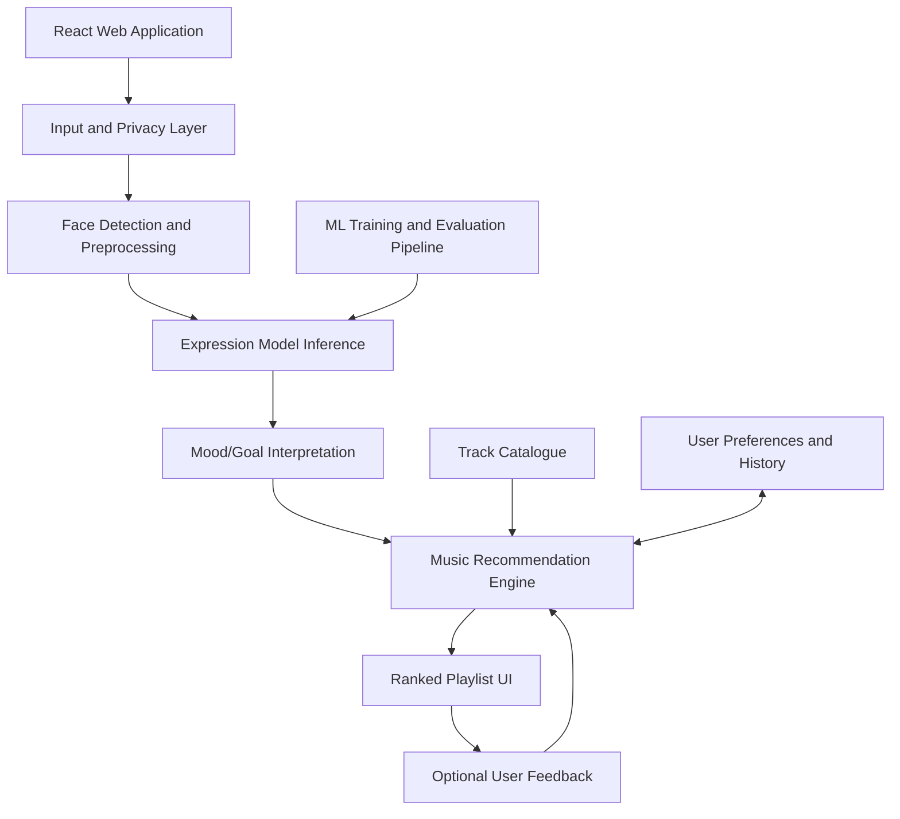
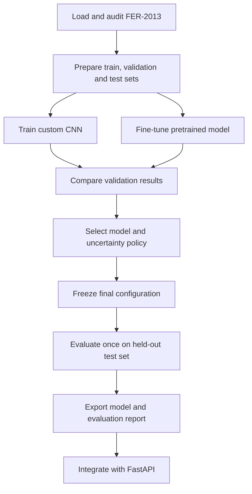

# Moodify — Project Blueprint

**Project title:** Moodify: AI-Powered Facial-Expression Recognition and Personalized Music Recommendation  
**Project type:** Final-year college project  
**Platform:** Web application  
**Core areas:** Computer Vision, Deep Learning, Recommendation Systems, Full-stack Development

---

## 1. Project Overview

Moodify is a web application that estimates facial-expression categories from a live camera feed, an uploaded image, or a captured photograph and uses the result as one input to recommend music. Recommendations also consider the user's selected listening goal, preferred genres and languages, track metadata, and feedback.

**Important scientific distinction:** facial-expression recognition estimates visible expressions; it cannot reliably determine a person's true internal emotional state. Moodify must allow users to correct a prediction or manually choose a listening goal.

### Problem Statement

Traditional music applications commonly rely on manual search, playlists, and historical listening preferences. Moodify will investigate whether facial-expression classification, combined with user-selected listening intentions and music preferences, can improve music-discovery relevance.

### Objectives

- Develop and evaluate a custom-trained or fine-tuned facial-expression classification model.
- Support live camera, uploaded image, and captured-photo input.
- Build a recommendation engine combining expression estimates, listening goals, track characteristics, and user preferences.
- Create a responsive music-discovery interface with feedback and optional history.
- Evaluate classification and recommendation performance separately.
- Implement privacy, security, uncertainty handling, and robust failure behavior.

### Research Questions

- **RQ1:** How does a custom CNN compare with a fine-tuned pretrained model on the same held-out facial-expression dataset?
- **RQ2:** How does model choice affect inference latency and practical deployment?
- **RQ3:** Does incorporating a user's chosen listening goal improve recommendation relevance compared with using expression predictions alone?
- **RQ4:** How robust is the system when input comes from a real webcam rather than a pre-cropped benchmark image?

---

## 2. Scope and Feature Priorities

### Must-have features

- Upload an image and receive an expression estimate.
- Capture a picture using the browser camera.
- Run controlled-rate inference from a live camera feed.
- Train and evaluate a facial-expression model.
- Return expression probabilities and handle uncertain predictions.
- Recommend a ranked list of tracks for a selected listening goal.
- Allow users to correct the predicted expression or select a goal manually.
- Support language and genre preferences.
- Validate files and handle camera, network, and inference errors.
- Avoid storing original face images by default.

### Should-have features

- Likes, skips, and ratings.
- User preference persistence.
- Optional recommendation-session history with deletion controls.
- Automated API, frontend, and end-to-end tests.
- Containerized deployment and reproducible model evaluation.

### Stretch features

- A hybrid recommender using feedback and listening history.
- Playlists that transition gradually between musical styles.
- External music-provider integration, subject to current API access and licensing.
- Model calibration and deeper robustness/fairness experiments.

**Scope-control rule:** If time is short, remove optional account management, playlist transitions, and external playback integration before removing model evaluation and testing.

---

## 3. Proposed Architecture

The application is organized into a React frontend, a Python API/backend, an ML inference pipeline, a recommendation engine, and a persistence layer.

### Logical flow

1. User chooses live camera, upload, or capture.
2. Input validation checks format, dimensions, size, and image quality.
3. Face detection locates a face and creates a crop.
4. Preprocessing matches the training pipeline.
5. The expression model returns class scores and an uncertainty status.
6. The user confirms/corrects the estimate or selects a listening goal.
7. The recommendation engine ranks tracks using goal fit, metadata, preferences, and available feedback.
8. The interface displays tracks and collects optional feedback.
9. Only explicitly requested history/preferences are persisted.

### Architecture diagram



For the first version, keep inference in the Python backend. This makes model versioning and latency measurement consistent. Send only the image needed for the current request and discard it after inference by default.

For live mode, sample frames at a controlled interval rather than uploading every frame. Smooth predictions across a short window to reduce flicker and avoid rebuilding playlists on every frame.

---

## 4. Recommended Technology Stack

| Layer | Technology | Purpose |
|---|---|---|
| Frontend | React, TypeScript, Vite | Web interface and reusable components |
| Styling | Tailwind CSS | Responsive styling |
| Camera | Browser MediaDevices API | Camera permission, live feed, image capture |
| Backend | Python, FastAPI | REST API and ML integration |
| ML framework | PyTorch | Model training, fine-tuning, checkpoints |
| Image processing | OpenCV, Pillow | Image validation, resizing, color conversion |
| Face detection | MediaPipe or a suitable OpenCV-based detector | Locate and crop faces |
| Data analysis | NumPy, pandas, scikit-learn | Dataset analysis and metrics |
| Visualization | Matplotlib | Training curves and confusion matrices |
| Database | PostgreSQL, SQLAlchemy | Preferences, tracks, feedback, optional history |
| Backend tests | pytest, HTTPX | Unit and API tests |
| Frontend tests | Vitest and suitable React testing tools | Component and interaction tests |
| Deployment | Docker | Reproducible environment |

Use a modular monolithic backend initially. Microservices add deployment and debugging overhead without a clear benefit at this project scale.

---

## 5. Suggested Repository Structure

```text
moodify/
├── frontend/
│   ├── src/
│   │   ├── components/
│   │   ├── pages/
│   │   ├── features/
│   │   │   ├── camera/
│   │   │   └── recommendations/
│   │   ├── services/api.ts
│   │   └── types/
│   └── tests/
├── backend/
│   ├── app/
│   │   ├── api/routes/
│   │   ├── core/config.py
│   │   ├── schemas/
│   │   ├── services/
│   │   ├── models/
│   │   ├── repositories/
│   │   └── main.py
│   └── tests/
├── ml/
│   ├── configs/
│   ├── data/
│   ├── notebooks/
│   ├── src/
│   │   ├── dataset.py
│   │   ├── preprocessing.py
│   │   ├── models.py
│   │   ├── train.py
│   │   ├── evaluate.py
│   │   └── predict.py
│   ├── checkpoints/
│   └── reports/
├── data/
│   └── catalogue/
├── docs/
│   ├── architecture/
│   ├── experiments/
│   ├── api/
│   └── report/
├── docker-compose.yml
├── .env.example
└── README.md
```

Do not commit large datasets, trained weights, secrets, or actual user photos to Git. Document how to obtain permitted datasets and reproduce training.

---

## 6. Dataset Strategy

### Primary dataset: FER-2013

FER-2013 contains approximately 35,887 images, typically 48 × 48 grayscale face images, labelled into seven expression classes. It is a practical starting benchmark for a compact CNN.

- Original challenge data: https://www.kaggle.com/c/challenges-in-representation-learning-facial-expression-recognition-challenge/data
- Verify the dataset terms and the precise split files available in the downloaded version.

### Optional dataset: FER+

FER+ adds annotations from multiple human labelers to FER-2013 images and can be useful for studying disagreement and ambiguity.

- Repository: https://github.com/microsoft/FERPlus
- Review its documentation and usage terms before use.

### Optional external test dataset: CK+

CK+ may help explore generalization beyond FER-2013. Access is governed by its terms and may be restricted to particular research uses.

- Access and agreement: https://ckplus.jeffcohn.net/request
- Obtain authorization before using it.

### Dataset recommendation

Start with FER-2013. Add FER+ only if time allows. Do not make the project dependent on access to a second dataset.

### Data preparation pipeline

1. Download the dataset and verify its source, terms, labels, and split definitions.
2. Audit class frequencies, malformed examples, image shapes, and label encoding.
3. Normalize pixel values consistently.
4. Apply data augmentation only to training data, such as modest rotations, translations, crops, and brightness changes.
5. Evaluate class weighting or a sampler if class imbalance materially affects performance.
6. Record split information, random seeds, configurations, and preprocessing decisions.
7. Keep the official test split out of training, hyperparameter tuning, and model selection.

Avoid aggressive transformations that may change the expression being classified. Do not relabel examples without a defensible annotation process.

---

## 7. Machine-Learning Plan

Train and compare two models under the same evaluation protocol.

### Model 1: Custom CNN baseline

Build a compact convolutional neural network with convolution, activation, pooling, dropout, and classification layers.

**Purpose:** provide a model whose architecture and training process can be explained clearly in a viva.

### Model 2: Fine-tuned pretrained model

Fine-tune a compact pretrained vision model such as MobileNetV3, adapting its input pipeline and classification head to the seven target classes.

**Purpose:** test whether transfer learning improves generalization, latency, or model efficiency compared with the custom CNN.

Do not assume the pretrained model will perform better. Measure it.

### Training and evaluation workflow



### Experimental controls

- Fix random seeds where practical.
- Record hardware, software versions, model configuration, and training settings.
- Use validation data for early stopping and model selection.
- Track training/validation loss, macro-F1, and per-class recall.
- Save the best validation checkpoint rather than simply the last epoch.
- Keep inference preprocessing consistent with training.
- Save a model card describing intended use, evaluation data, limitations, and failure cases.

### Metrics to report

| Metric | What it measures |
|---|---|
| Accuracy | Overall proportion of correct predictions |
| Macro-F1 | Class-balanced summary of precision and recall |
| Per-class precision | Correctness of predictions for each class |
| Per-class recall | Fraction of each class detected |
| Confusion matrix | Which classes are confused |
| Inference latency | Time taken to produce predictions |
| Model size | Storage and deployment cost |

Report actual measurements. Do not promise an accuracy figure before experiments are complete.

### Confidence and uncertainty

Return class probabilities and an uncertainty status. Select a confidence/uncertainty policy using validation data, not the final test set. If the estimate is uncertain, show that the model could not make a reliable prediction and offer manual mood selection.

Softmax values are not automatically calibrated probabilities. If feasible, assess calibration separately.

Benchmark real webcam captures as well as benchmark images. FER-2013 uses small pre-cropped grayscale faces, while camera input may have different lighting, pose, occlusion, and image quality. Report this domain gap as a limitation.

---

## 8. Image Inference Pipeline

1. Receive an uploaded image or camera frame.
2. Validate format, dimensions, and maximum file size.
3. Detect a face using MediaPipe or another suitable detector.
4. Return a controlled error or ask for a new capture if no face is found or image quality is inadequate.
5. Crop and preprocess the face using the same steps used during training.
6. Run the classifier and apply the uncertainty policy.
7. Return the expression label, class probabilities, status, and model version.
8. Discard the image after inference by default.

For live video, run inference every few hundred milliseconds rather than on every frame. Smooth predictions over a short window and refresh recommendations only when the estimate is sufficiently stable or the user asks.

### Example prediction response

```json
{
  "expression": "happy",
  "confidence": 0.82,
  "probabilities": {
    "angry": 0.02,
    "disgust": 0.01,
    "fear": 0.02,
    "happy": 0.82,
    "sad": 0.03,
    "surprise": 0.04,
    "neutral": 0.06
  },
  "status": "prediction_available",
  "model_version": "moodify-fer-v1"
}
```

These values illustrate the response format only; they are not measured Moodify results.

---

## 9. Music Recommendation Engine

Develop the recommender independently from the expression classifier so that it can be tested without the ML service.

### Track catalogue

Start with approximately 300–1,000 tracks if suitable metadata can be obtained legally and reliably. Potential fields include:

- Track ID, title, artist, and album.
- Genre and language.
- Tempo and energy, when reliable metadata is available.
- Mood-related tags such as calm, uplifting, reflective, or intense.
- A licensed preview, playable source URL, or external listening link.
- Data source and licensing notes.

If a suitably licensed music dataset is unavailable, begin with a manually curated catalogue and document how it was assembled. Do not distribute copyrighted audio or scrape protected catalogues without permission.

### Recommendation strategies

**Strategy 1 — Rule-based baseline:** use predefined tags and transparent rules to match tracks to a selected listening goal.

**Strategy 2 — Content-based ranking:** score tracks using their metadata and the user's selected goal and preferences.

**Strategy 3 — Feedback-aware hybrid (stretch):** combine content relevance with signals from likes, skips, ratings, and previous sessions.

### Example scoring function

\[
R(u,t,g)=w_1M(t,g)+w_2P(u,t)+w_3F(u,t)
\]

Where:

- \(M(t,g)\) measures how well track \(t\) matches listening goal \(g\).
- \(P(u,t)\) measures how well the track fits user \(u\)'s preferences.
- \(F(u,t)\) represents feedback-based relevance.
- \(w_1,w_2,w_3\) are weights selected through validation or a documented experiment.

For a new user with no history, use sensible defaults and explicitly collected preferences. Do not claim feedback-based personalization works until sufficient interactions have been collected and evaluated.

### Listening goals

Let users choose what they want music to do:

- Comfort me.
- Lift my mood.
- Match my current vibe.
- Help me relax.
- Energize me.
- Help me focus.

A sad-expression estimate should not automatically force upbeat music on the user. The user's selected intention should have meaningful influence over the ranking.

### Recommendation evaluation

| Experiment | Research question |
|---|---|
| Rule-based vs. content-based | Does feature-based ranking improve relevance? |
| Content-based vs. hybrid | Does feedback improve ranking when interaction data is available? |
| Expression alone vs. expression + chosen goal | Does user control improve perceived relevance? |
| Generic vs. personalized playlist | Do preferences improve satisfaction? |

Use Precision@K, Recall@K, or NDCG@K when suitable relevance labels or held-out interactions are available. For a small user study, collect relevance and satisfaction ratings, clearly identifying them as subjective responses.

Do not claim Moodify improves mental health or objectively measures happiness.

---

## 10. Database Design

Use PostgreSQL for persistent information. Do not store original face images by default.

| Table | Example fields |
|---|---|
| `users` | `id`, `email`, `password_hash`, `created_at` |
| `user_preferences` | `user_id`, `genres`, `languages`, `listening_goals` |
| `tracks` | `id`, `title`, `artist`, `language`, `genre`, `energy`, `tags`, `source_url` |
| `recommendation_sessions` | `id`, `user_id`, `expression_label`, `listening_goal`, `created_at` |
| `recommendation_items` | `session_id`, `track_id`, `rank`, `score` |
| `user_feedback` | `user_id`, `track_id`, `feedback_type`, `created_at` |

Authentication can be optional in the first prototype. If accounts are implemented, hash passwords with a suitable password-hashing library, enforce authorization on protected endpoints, and store secrets in environment variables.

Store expression history only when required for an explicit, user-controlled history feature. Provide deletion controls and explain what is retained.

---

## 11. API Design

Keep the API small and versioned.

| Endpoint | Method | Purpose |
|---|---|---|
| `/api/v1/health` | GET | Health check |
| `/api/v1/expressions/predict` | POST | Predict expression from an uploaded image |
| `/api/v1/recommendations` | POST | Generate ranked tracks |
| `/api/v1/tracks` | GET | Browse/filter the catalogue |
| `/api/v1/preferences` | GET/PUT | Retrieve/update preferences |
| `/api/v1/feedback` | POST | Record a like, skip, or rating |
| `/api/v1/history` | GET | Retrieve permitted session history |
| `/api/v1/history` | DELETE | Delete the user's history |

### Example recommendation request

```json
{
  "expression": "sad",
  "listening_goal": "lift_my_mood",
  "languages": ["Hindi", "English"],
  "genres": ["pop", "indie"],
  "limit": 10
}
```

Validate expression labels against supported values, constrain result counts, and validate user preferences. Do not trust a client-supplied expression as verified model output. Run inference server-side in the same workflow or clearly distinguish manual selections from model predictions.

### API safety and reliability

- Return clear errors for invalid images and no-face results.
- Reject oversized files, unsupported formats, and malformed requests.
- Return a controlled uncertainty status rather than inventing a confident prediction.
- Do not log image contents.
- Rate-limit expensive endpoints and protect against unauthorized access.

---

## 12. Testing Strategy

### Level 1 — ML unit tests

Test label mappings, tensor dimensions, normalization, checkpoint loading, probability output, deterministic inference where applicable, and invalid inputs.

**Acceptance:** valid inputs produce valid outputs; invalid inputs are handled without crashing.

### Level 2 — Model evaluation

Compare the custom CNN and fine-tuned model on the same held-out test set. Measure accuracy, macro-F1, per-class recall, confusion matrix, latency, and model size.

**Acceptance:** evaluation results can be regenerated from a documented script and checkpoint.

### Level 3 — API integration tests

Test upload validation, no-face results, recommendation ranking, invalid preferences, database persistence, and authorization if enabled.

**Acceptance:** expected HTTP responses, schemas, and error handling are verified automatically.

### Level 4 — Frontend and end-to-end tests

Test camera permissions, upload, capture, prediction display, manual mood selection, playlist generation, feedback, and history deletion.

**Acceptance:** the main user journey works from start to finish in the target browser.

### Level 5 — Robustness and privacy

Test poor lighting, multiple faces, occlusion, low-resolution images, denied camera access, network failure, repeated requests, and history deletion.

**Acceptance:** the application responds safely, explains limitations, and does not silently store images.

### Example acceptance criteria

| Area | Target |
|---|---|
| Functional correctness | All critical user journeys pass |
| Model quality | Macro-F1 and per-class recall meet a documented target chosen after baseline measurement |
| Responsiveness | Report median and 95th-percentile latency on specified hardware |
| Recommendation quality | Compare against a rule-based baseline using the same evaluation set |
| Robustness | Defined edge cases produce controlled responses |
| Privacy | Original images are not persisted after inference by default |
| Reproducibility | Documented commands reproduce evaluation results from the selected checkpoint |

Measure latency on stated hardware and clarify whether it includes upload, face detection, preprocessing, inference, and response time. Benchmark components separately and end-to-end.

For a user study, recruit participants with informed consent and institutional approval where required. Do not use their images for training without a separate appropriate consent and data-management process.

---

## 13. Ten-Week Development Plan

| Week | Focus | Deliverable |
|---|---|---|
| 1 | Requirements, research questions, architecture, dataset terms, UI wireframes | Proposal and architecture diagram |
| 2 | Dataset audit, preprocessing, baseline CNN | Data audit and baseline metrics |
| 3 | CNN experiments, augmentation, class-imbalance experiments | Trained CNN and experiment logs |
| 4 | Fine-tuning, validation comparison, held-out evaluation | Model comparison report |
| 5 | Face detection, inference pipeline, FastAPI endpoints | Working inference API |
| 6 | Frontend, camera permission flow, upload/capture, prediction display | End-to-end expression recognition |
| 7 | Track catalogue, ranking baseline, listening goals, playlist UI | Working recommendations |
| 8 | Preferences, feedback, optional history and deletion | Personalized experience |
| 9 | Integration tests, latency, robustness, recommendation comparison, user study | Testing and evaluation report |
| 10 | Deployment, fixes, report, slides, viva rehearsal | Final application and submission |

If time is short, cut optional account management, playlist transitions, or external streaming integration before cutting model evaluation and testing.

---

## 14. Final-Year Report Structure

1. **Introduction:** background, problem statement, motivation, objectives, and scope.
2. **Literature Review:** facial-expression recognition, CNNs, transfer learning, music recommendation, and research gaps.
3. **Requirements and System Design:** functional/non-functional requirements, use cases, architecture, UML, and data flow.
4. **Dataset and Preprocessing:** sources, class distribution, splits, augmentation, and ethical considerations.
5. **Model Methodology:** CNN architecture, transfer learning, loss function, optimizer, hyperparameters, and training procedure.
6. **Recommendation Methodology:** track features, scoring, listening goals, personalization, and feedback.
7. **Implementation:** frontend, API, database, inference pipeline, and deployment.
8. **Experiments and Results:** classification metrics, confusion matrix, model comparison, latency, and recommendation evaluation.
9. **Testing and Discussion:** functional tests, robustness, user feedback, failures, and limitations.
10. **Conclusion and Future Work:** findings, contribution, limitations, and realistic extensions.

Append dependency versions, training configuration, dataset references, experiment logs, API documentation, and screenshots where appropriate. Never invent results.

---

## 15. Viva Preparation

### Machine learning and computer vision

1. Why use CNNs rather than traditional machine-learning algorithms for expression classification?
2. What is the difference between training from scratch and transfer learning?
3. Why are training, validation, and test sets separate?
4. What is overfitting, and how do dropout, augmentation, and early stopping help?
5. Why is macro-F1 useful when classes are imbalanced?
6. What is the difference between a softmax score and a calibrated probability?

### Recommendation systems

7. What is the difference between content-based and collaborative filtering?
8. Why begin with a rule-based recommender?
9. How do you handle a new user with no listening history?
10. How do you evaluate recommendation quality independently from classification accuracy?

### System design and ethics

11. Why choose React and FastAPI?
12. How does live inference work without uploading every frame?
13. What happens when no face is detected or the prediction is uncertain?
14. Why can't facial-expression classification reliably determine internal emotional state?
15. How do you protect privacy, and what are the limitations of your datasets?

A strong answer should connect the theory to actual implementation decisions and measured results. Be prepared to explain why users can override model predictions.

---

## 16. Risks and Mitigations

| Risk | Mitigation |
|---|---|
| Poor generalization to webcam images | Evaluate consented real-world samples and document domain shift |
| Imbalanced classes | Report per-class metrics and test class weighting or sampling |
| Weak mood-to-song mapping | Let users select a listening goal and correct expression estimates |
| Insufficient music metadata | Start with a curated catalogue and document sources/licensing |
| Slow inference | Use a compact model, controlled frame sampling, and latency benchmarks |
| Scope creep | Protect ML, recommendation, and evaluation milestones |
| Privacy concerns | Avoid default image retention, minimize logs, and provide controls |
| Unreproducible results | Version configurations, dependencies, seeds, checkpoints, and split manifests |

---

## 17. What Makes Moodify Academically Strong?

The primary contribution should be the combination of **evaluated facial-expression recognition and user-guided personalized music recommendations**, rather than claiming to have invented a new emotion-recognition algorithm.

The final submission should include:

- A trained and reproducible model.
- A documented comparison of at least two model approaches.
- A web application supporting all three image-input modes.
- A recommendation engine with a measurable baseline and personalized variant.
- Automated tests and documented deployment.
- An experimental report discussing uncertainty, failures, privacy, and limitations.
- A live demonstration from camera input to playlist.
- Reproducible scripts, model configuration, and measured results.

A carefully measured negative result can still be academically valuable. The project should demonstrate sound methodology, honest interpretation, and thoughtful engineering.

---

## 18. First Milestone

Begin with the project foundation rather than UI polish.

During Week 1:

1. Create the repository and basic development environment.
2. Finalize the problem statement, objectives, and research questions.
3. Confirm dataset sources, access, usage terms, and split strategy.
4. Sketch the user journey and architecture.
5. Define the baseline metrics and evaluation protocol.
6. Create the project backlog and initial report outline.

Once these decisions are stable, develop the model, backend, and frontend in parallel and integrate them through documented interfaces.

**Project principle:** Build a system you can explain down to its training pipeline, demonstrate live, and defend with experimental evidence—not merely a good-looking application.

---

## References and starting resources

- FER-2013 challenge data: https://www.kaggle.com/c/challenges-in-representation-learning-facial-expression-recognition-challenge/data
- Microsoft FER+: https://github.com/microsoft/FERPlus
- CK+ access: https://ckplus.jeffcohn.net/request
- PyTorch: https://pytorch.org/
- FastAPI: https://fastapi.tiangolo.com/
- React: https://react.dev/
- MediaPipe: https://ai.google.dev/edge/mediapipe/solutions/vision/face_detector
- scikit-learn metrics: https://scikit-learn.org/stable/modules/model_evaluation.html

**Note:** Verify dataset access, license terms, API availability, and third-party music-provider restrictions before implementation. This blueprint is a project plan, not a claim that the model or application has already been built or evaluated.
